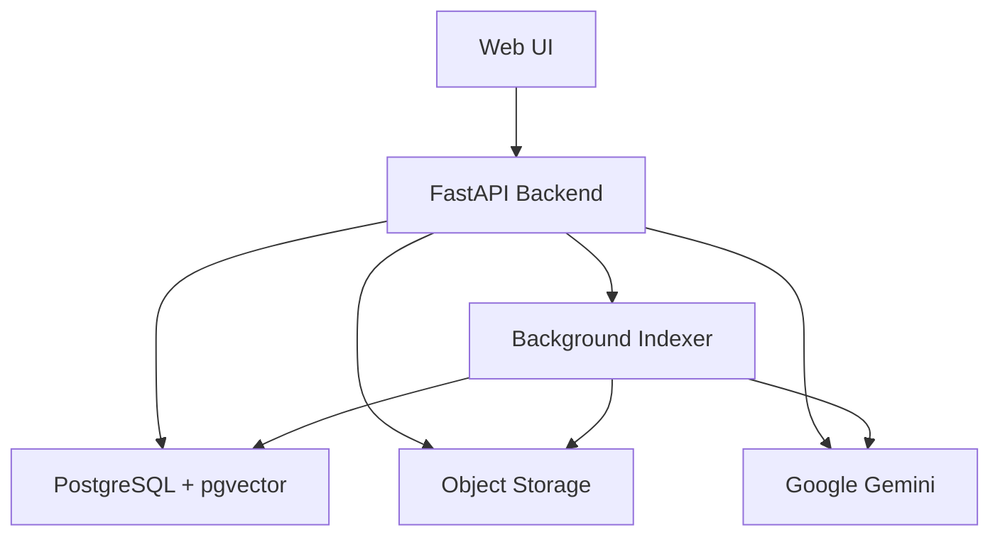
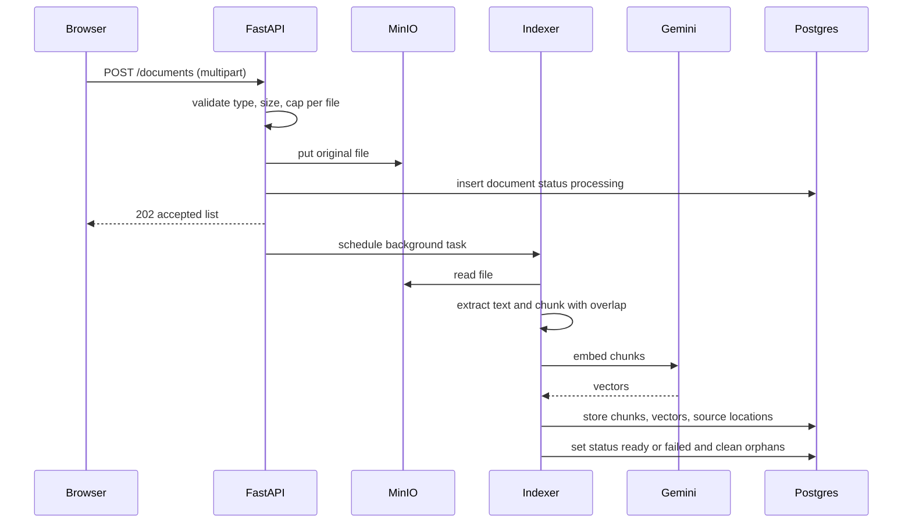
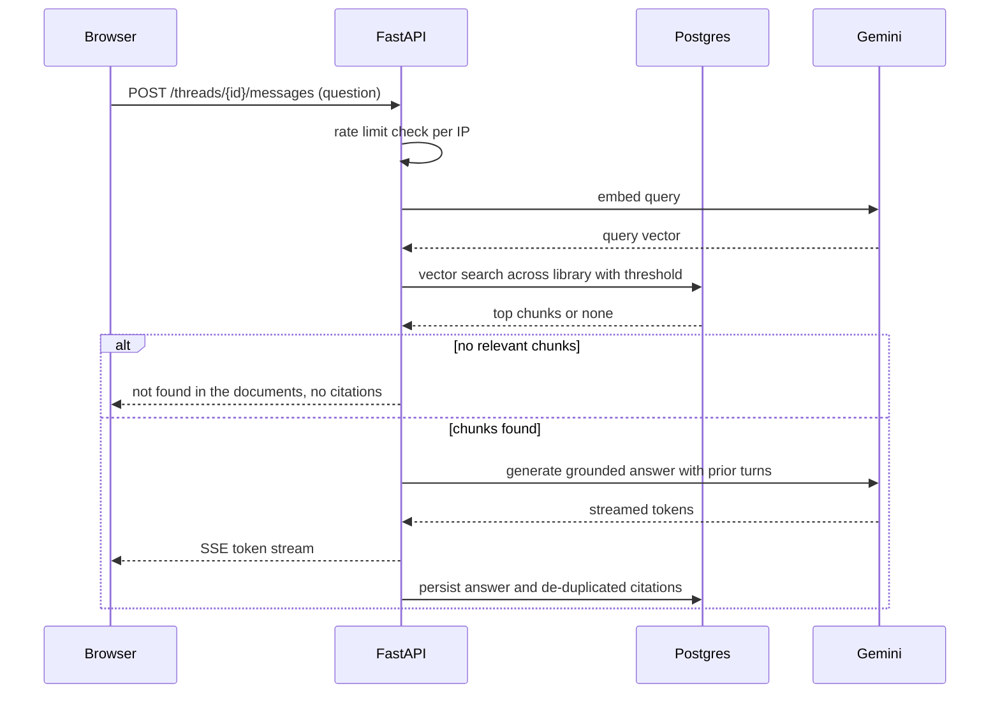
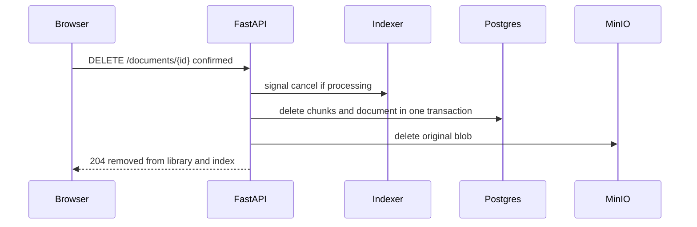
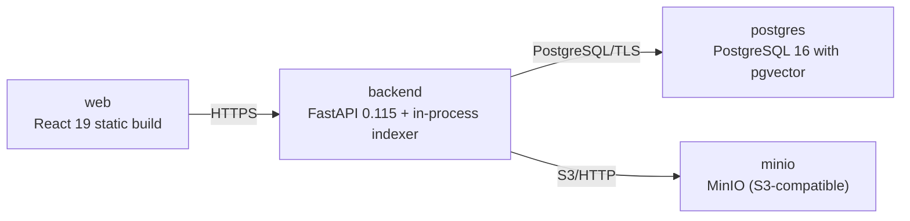

# Architecture

> Maintained by QuorQ AI SDLC. Text between `sdlc:auto` markers is regenerated; anything outside them is yours and is kept.

<!-- sdlc:auto:start narrative -->
## Overview

### ARCH-V1 · approved · source: architecture:version-1

Approved architecture (v1) for a lightweight, fully open (no-login) RAG chatbot. Shared library upload/index/chat with Gemini embeddings and generation, streamed cited responses, shared conversation history. Stack used exactly as approved: React 19, FastAPI 0.115, PostgreSQL 16 + pgvector, MinIO, Gemini. Deployed on AWS at 5-25 user scale with per-IP rate limiting and document cap as only abuse guards.

Summary: lightweight, fully open (no-login) RAG chatbot for a small team to upload PDF/DOCX/TXT/Markdown into one shared library; background indexing via text extraction, overlapping chunking, Gemini embedding; answers strictly from documents with streamed, cited responses and shared conversation history. Approved stack used exactly: React 19 frontend, FastAPI 0.115 backend hosting in-process background indexer (no queue), PostgreSQL 16 with pgvector holding file records/chunks/embeddings/threads, MinIO for original file blobs, Gemini for embeddings and generation on single server-side key. Deployed on AWS at 5-25 user scale; per-IP rate limiting and document cap are only abuse guards.

**Related:** EPIC-001, EPIC-002, EPIC-003, EPIC-004, EPIC-005

### ARCH-COMP-FRONTEND · approved · source: architecture:component:frontend

Web UI (React 19). Responsive two-area React app: chat screen with thread sidebar and streamed answers plus expandable citations, and documents screen for upload, library listing with live status, and deletion.

Frontend consumes SSE token stream for progressive answers and polls document status for live indexing progress. Builds responsive two-area layout (chat with thread sidebar plus documents screen).

**Related:** ARCH-V1, US-018, US-011

### ARCH-COMP-API · approved · source: architecture:component:api

FastAPI Backend (FastAPI 0.115). Serves REST and streaming endpoints for uploads, document library, chat retrieval+generation, citations, conversation threads. Enforces per-IP rate limits and document cap; schedules background indexing.

Handles multipart uploads, streaming (SSE) answer responses, per-IP rate limiting, and hosts background indexer in-process so no separate queue is required. Python's mature libraries extract PDF/DOCX text.

**Related:** ARCH-V1, US-001, US-004, US-005, US-007, US-013, US-014, US-019

### ARCH-COMP-INDEXER · approved · source: architecture:component:indexer

Background Indexer (FastAPI 0.115 BackgroundTasks / asyncio worker). In-process background task runner: extract text, split into overlapping chunks, request Gemini embeddings, write chunks+vectors+source locations, set document status processing/ready/failed with retries and cleanup.

Runs in-process so no separate queue service is needed. Performs retries and cleanup on failure; no partial/orphaned chunks left in index on failure.

**Related:** ARCH-V1, US-002, US-003, US-005

- ⚠ Concurrency/capacity limits of in-process indexer at upper end of 5-25 users not quantified.

### ARCH-COMP-DB · approved · source: architecture:component:db

PostgreSQL + pgvector (PostgreSQL 16). Single store for document records and status, text chunks, embedding vectors (pgvector), shared conversation threads and messages with citations.

One database holds document records, chunks, pgvector embeddings and shared threads/messages so deleting a document removes its vectors in the same transaction—no second system to keep in sync. Similarity search over a few thousand chunks is fast.

**Related:** ARCH-V1, US-005, US-007, US-013, US-014

### ARCH-COMP-STORAGE · approved · source: architecture:component:storage

Object Storage (MinIO, S3-compatible; container bitnamilegacy/minio:2024.10.13). Stores original uploaded files, deleted in same flow as document record.

MinIO S3-compatible object storage for original file blobs; deletion of a document removes the stored original in the same flow as the document record.

**Related:** ARCH-V1, US-001, US-005

### ARCH-COMP-GEMINI · approved · source: architecture:component:gemini

Google Gemini (external SaaS). Provides embeddings for chunks and grounded answer generation; called only server-side on GEMINI_API_KEY.

Gemini is used for both embeddings and generation on a single server-side key supplied by the operator. Costs sit on the operator's account; no payments/plans/billing in the product.

**Related:** ARCH-V1, US-002, US-007, US-020

- ⚠ Specific Gemini model identifiers for embeddings and generation not named in architecture input.
<!-- sdlc:auto:end narrative -->

<!-- sdlc:auto:start building-blocks -->
## Building Block View

| ID | Name | Technology | Responsibility | Depends on |
|---|---|---|---|---|
| frontend | Web UI | React 19 | Responsive two-area React app: chat screen with thread sidebar and streamed answers plus expandable citations, and a documents screen for upload, library listing with live status, and deletion. | api |
| api | FastAPI Backend | FastAPI 0.115 | Serves REST and streaming endpoints for uploads, document library, chat retrieval+generation, citations and conversation threads. Enforces per-IP rate limits and the document cap, and schedules background indexing. | db, storage, gemini, indexer |
| indexer | Background Indexer | FastAPI 0.115 (BackgroundTasks / asyncio worker) | In-process background task runner that extracts text, splits into overlapping chunks, requests Gemini embeddings, writes chunks+vectors+source locations, and sets document status processing/ready/failed with retries and cleanup. | db, storage, gemini |
| db | PostgreSQL + pgvector | PostgreSQL 16 | Single store for document records and status, text chunks, embedding vectors (pgvector), and shared conversation threads and messages with citations. | — |
| storage | Object Storage | MinIO (S3-compatible) | Stores the original uploaded files, deleted in the same flow as the document record. | — |
| gemini | Google Gemini | Google Gemini | External SaaS providing embeddings for chunks and grounded answer generation, called only server-side on GEMINI_API_KEY. | — |

<!-- sdlc:auto:end building-blocks -->

<!-- sdlc:auto:start runtime -->
## Runtime View

### Upload and background indexing

Browser uploads supported files (validated for type and ~25MB size and against the document cap), each stored to MinIO with a 'processing' record, then an in-process background task extracts text, overlap-chunks, embeds via Gemini with retries, and marks ready or failed with cleanup.

- **Components:** frontend, api, indexer, db, storage, gemini
- **Modules:** routers/documents.py, services/upload.py, services/extract.py, services/chunk.py, services/embed.py, workers/indexer.py
- **Key functions:** upload_documents(files), validate_file(name, size), enforce_document_cap(), schedule_indexing(doc_id), extract_text(blob, mime), chunk_text(text, overlap), embed_chunks(chunks), finalize_status(doc_id, status, reason)

### Grounded chat with streamed cited answer

A question in a thread is embedded, matched against the whole library via pgvector similarity, grounded against retrieved chunks with prior thread turns as context, generated by Gemini and streamed token by token, then persisted with de-duplicated citations or a 'not found' reply.

- **Components:** frontend, api, db, gemini
- **Modules:** routers/chat.py, services/retrieval.py, services/generation.py, services/threads.py
- **Key functions:** ask(thread_id, question), embed_query(text), retrieve_chunks(vector, top_k, threshold), build_context(thread_id, chunks), stream_answer(prompt), persist_message(thread_id, answer, citations), auto_title(thread_id, first_question)

### Delete document and purge from index

Any visitor confirms deletion, the API stops any in-flight indexing, removes chunks and embeddings and the document record in one transaction and deletes the original blob, so no citation from it can appear in future answers.

- **Components:** frontend, api, indexer, db, storage
- **Modules:** routers/documents.py, services/delete.py, workers/indexer.py
- **Key functions:** delete_document(doc_id), cancel_indexing(doc_id), purge_chunks(doc_id), delete_blob(doc_id)

<!-- sdlc:auto:end runtime -->

<!-- sdlc:auto:start deployment-view -->
## Deployment View

| Name | Service | Runtime | Scaling | Environment |
|---|---|---|---|---|
| web | React 19 static build | Served via backend or CDN | single instance | dev |
| backend | FastAPI 0.115 + in-process indexer | Python 3.12 (uvicorn) on smallest AWS instance | single instance | dev |
| postgres | PostgreSQL 16 with pgvector | Managed Postgres (AWS RDS) smallest instance | single instance | dev |
| minio | MinIO (S3-compatible) | Container bitnamilegacy/minio:2024.10.13 | single instance | dev |

| Source | Target | Protocol |
|---|---|---|
| web | backend | HTTPS |
| backend | postgres | PostgreSQL/TLS |
| backend | minio | S3/HTTP |

<!-- sdlc:auto:end deployment-view -->

<!-- sdlc:auto:start decisions -->
## Architecture Decisions

| Layer | Choice | ADR |
|---|---|---|
| Frontend | React 19 | [ADR-0001](adr/frontend.md) |
| Backend | FastAPI 0.115 | [ADR-0002](adr/backend.md) |
| Database | PostgreSQL 16 | [ADR-0003](adr/database.md) |
| Cloud | AWS | [ADR-0004](adr/cloud.md) |
<!-- sdlc:auto:end decisions -->

<!-- sdlc:auto:start links -->
## Related Documents

- [Data Model](data-model.md)
- [API Specification](api/openapi.yaml)
- [Architecture Decision Records](adr/README.md)
<!-- sdlc:auto:end links -->
