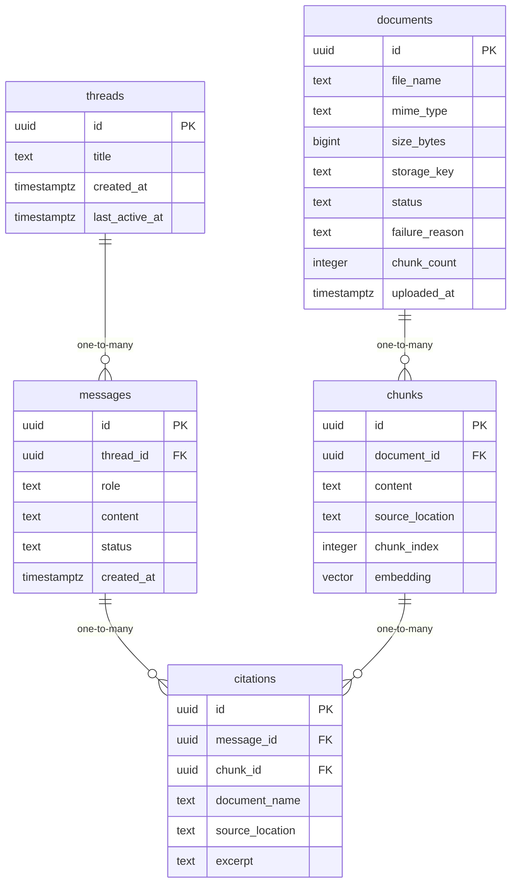

# Data Model

<!-- sdlc:auto:start entities -->
### documents

| Field | Type | PK | FK | Nullable |
|---|---|---|---|---|
| id | uuid | True | — | False |
| file_name | text | False | — | False |
| mime_type | text | False | — | False |
| size_bytes | bigint | False | — | False |
| storage_key | text | False | — | False |
| status | text | False | — | False |
| failure_reason | text | False | — | True |
| chunk_count | integer | False | — | True |
| uploaded_at | timestamptz | False | — | False |

### chunks

| Field | Type | PK | FK | Nullable |
|---|---|---|---|---|
| id | uuid | True | — | False |
| document_id | uuid | False | documents.id | False |
| content | text | False | — | False |
| source_location | text | False | — | False |
| chunk_index | integer | False | — | False |
| embedding | vector | False | — | False |

### threads

| Field | Type | PK | FK | Nullable |
|---|---|---|---|---|
| id | uuid | True | — | False |
| title | text | False | — | True |
| created_at | timestamptz | False | — | False |
| last_active_at | timestamptz | False | — | False |

### messages

| Field | Type | PK | FK | Nullable |
|---|---|---|---|---|
| id | uuid | True | — | False |
| thread_id | uuid | False | threads.id | False |
| role | text | False | — | False |
| content | text | False | — | False |
| status | text | False | — | False |
| created_at | timestamptz | False | — | False |

### citations

| Field | Type | PK | FK | Nullable |
|---|---|---|---|---|
| id | uuid | True | — | False |
| message_id | uuid | False | messages.id | False |
| chunk_id | uuid | False | chunks.id | True |
| document_name | text | False | — | False |
| source_location | text | False | — | False |
| excerpt | text | False | — | False |
<!-- sdlc:auto:end entities -->

<!-- sdlc:auto:start relationships -->
| Source | Target | Type |
|---|---|---|
| documents | chunks | one-to-many |
| threads | messages | one-to-many |
| messages | citations | one-to-many |
| chunks | citations | one-to-many |
<!-- sdlc:auto:end relationships -->

<!-- sdlc:auto:start er-diagram -->

<!-- sdlc:auto:end er-diagram -->
