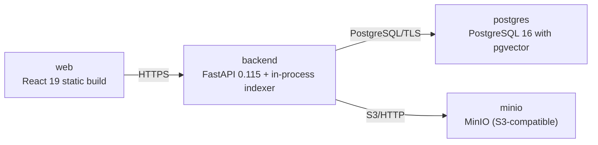

# Deployment Guide

> Maintained by QuorQ AI SDLC. Text between `sdlc:auto` markers is regenerated; anything outside them is yours and is kept.

<!-- sdlc:auto:start how-it-deploys -->
Pushes to `main` run `.github/workflows/deploy.yml`, which builds the API image (if there is a backend) and deploys the SPA to AWS Amplify. Commits touching only `docs/sdlc/**` don't deploy. Deployments can also be started from the platform's Deployment tab.
<!-- sdlc:auto:end how-it-deploys -->

<!-- sdlc:auto:start environments -->
| Name | Service | Runtime | Scaling | Environment |
|---|---|---|---|---|
| web | React 19 static build | Served via backend or CDN | single instance | dev |
| backend | FastAPI 0.115 + in-process indexer | Python 3.12 (uvicorn) on smallest AWS instance | single instance | dev |
| postgres | PostgreSQL 16 with pgvector | Managed Postgres (AWS RDS) smallest instance | single instance | dev |
| minio | MinIO (S3-compatible) | Container bitnamilegacy/minio:2024.10.13 | single instance | dev |
<!-- sdlc:auto:end environments -->

<!-- sdlc:auto:start live -->
**Frontend URL:** https://p080e9ceea596.dwzhwrawu50o7.amplifyapp.com

**Backend URL:** https://34.204.217.28:8443/apps/080e9ceea596/

**Database:** PostgreSQL · aisdlc_080e9ceea5964933

**Version:** a5588d689738

**Commit:** `a5588d6`

**Finished:** 2026-10-19
<!-- sdlc:auto:end live -->

<!-- sdlc:auto:start topology -->

<!-- sdlc:auto:end topology -->
